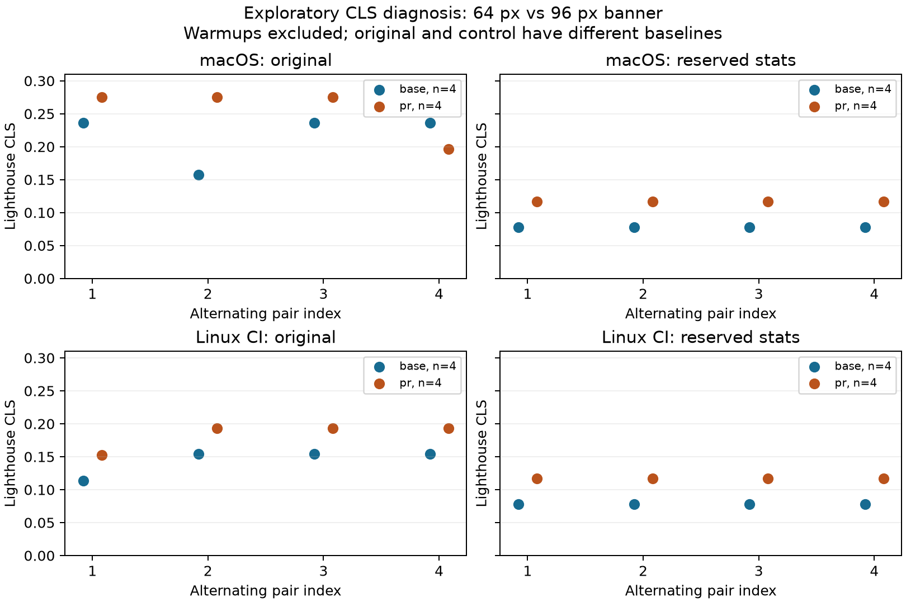

# CLS calibration diagnosis, 30 October 2026

This is exploratory follow-up to the first frozen-policy pilot. It does not change
browser-candidate-2026-10-30 or turn the inspected pilot into a fresh holdout.

## What the recorded pilot actually shows

The earlier validation report describes the +25% case through its aggregate median
(+0.25% observed CLS). That number is correct, but "the injector failed" is not an
established causal explanation. Inspection of the full observations reveals two
very narrow modes in both variants, separated by the same 0.076782278741 units.

| Nominal case | Baseline low / high count | Treatment low / high count | Low-mode CLS, baseline → treatment |
|---|---:|---:|---|
| +2% | 20 / 0 | 20 / 0 | 0.154463 → 0.157558 |
| +5% | 11 / 9 | 14 / 6 | 0.154463 → 0.162228 |
| +10% | 16 / 4 | 19 / 1 | 0.154463 → 0.170012 |
| +25% | 10 / 10 | 15 / 5 | 0.154463 → 0.193345 |

In the +25% job, the even-sample baseline median averages the two modes:
(0.154462960715 + 0.231245239457) / 2 = 0.192854100086.
The treatment median is its lower mode, 0.193345099233. Their ratio gives +0.25%,
although the low mode increased +25.17% and the mean increased +10.21%.

Conditioning on modes is a diagnostic description, not a replacement endpoint or
permission to discard high-mode samples. Mode occupancy could depend on timing or
treatment. Neither this decomposition nor the aggregate mean establishes a causal
effect for an individual load. The frozen gate's missed target remains a missed
target under its predeclared rule.

## Trace follow-up

scripts/diagnose-cls.mjs captures complete Lighthouse traces, reports, per-event
layout shifts and affected DOM elements. It uses the same pinned Chrome, cold
browser launch, devtools throttling and alternating order as the collector, while
remaining an independent exploratory tool. Traces are diagnostic, not additional
confirmatory comparisons. Local and hosted findings must be distinguished.

CLS is the largest session-window sum of layout-shift scores; scores depend on
viewport movement, not simply banner height. See the primary
[CLS specification guide](https://web.dev/articles/cls).

## Controlled diagnostic design (declared before collection)

Two pages use the same built JavaScript and content. The original heavy.html is
unaltered. A separate heavy-reserved.html adds only a fixed 200 px stats container
with overflow clipped, preventing its asynchronous children from changing the
height occupied by that region. This is an intervention on the suspected confound,
not an optimized replacement for the historical benchmark.

For each page, capture four alternating base/treatment pairs after two warmups per
variant. Baseline banner is 64 px; treatment is 96 px. The reserved control has a
different CLS baseline, so its treatment is **not labelled nominal +25% CLS**.
Inspect all traces, including warmups; report measurement summaries separately.
The intervention is intended to test whether stats-region growth contributes to
the extra shifts and whether reserving that region isolates banner displacement.
A local experiment cannot establish exact Linux behavior; run both pages in a
manual hosted workflow with pinned Chrome before attributing the historical modes.
This small fixed diagnostic sample is not a statistical power experiment.

## Trace evidence

On macOS, an original-page low observation contains three shifts:
0.042207766 (catalog moves 84 px), 0.037256564 (catalog moves another 96 px),
and 0.077764277 (64 px banner moves the page). The reported CLS is 0.157228607.
A high observation instead has the first shift and a combined second shift of
0.194410693, whose maximum movement is 160 px (96 + 64). CLS is 0.236618458.
The additional 0.079389851 comes from the different grouping of movements across
rendered frames. The trace lists main/header nodes for the combined shift while
its maximum-distance field also reflects the larger descendant displacement.

The hosted Linux trace records smaller stats displacements (81 and 93 px),
consistent with platform-dependent text geometry. Its ordinary three-event sum is
0.040479747 + 0.036218936 + 0.077764277 = 0.154462961, exactly the historical lower
mode. The analogous combined-frame calculation, 0.040479747 + (93 + 64)/823,
reproduces the historical upper mode 0.231245239. This upper-mode reconstruction
is an inference supported by the local trace mechanism, not a high-mode Linux
trace captured in this small follow-up.

The new Linux series also exposes a different lower result: one measured load per
variant marks its first shift had_recent_input=true, so Lighthouse excludes that
event. The resulting CLS values are 0.113983213 / 0.152865352. The trace proves the
exclusion flag; this experiment does not establish why Chrome set it in that load.
This is retained rather than removed as an inconvenient observation.

With the stats region reserved, all hosted control traces contain only the banner
shift: 64/823 = 0.077764277 or 96/823 = 0.116646416. That is a +50% change relative
to the new control baseline, not a recalibration of the original nominal +25% case.
The four measured loads per variant and both warmups per variant all agree.

## Interpretation and limits

The banner intervention is present. The original metric is a nonlinear aggregate
of multiple layout changes, and its sample median can change drastically when
mode occupancy changes. A nominal percentage inferred from one calibration session
is therefore not a portable guarantee of the subsequent measured median effect.
The controlled page isolates the mechanism in this small experiment; it does not
replace the mixed-layout workload or prove broad false-alarm/power guarantees.

Keep the original cohort, including failed target detections, in the study. Future
calibration should report complete distributions and realized effects, and use a
separate workload identifier for the reserved control. Do not select or drop modes,
change the frozen threshold, or relabel a diagnostic run as confirmatory evidence.

## Completed series and reproducibility

48 complete traces were archived: 32 measured loads and 16 warmups. Each of the
four series has four measured loads per variant and two warmups per variant.

| Platform / page | Baseline median CLS | 96 px median CLS |
|---|---:|---:|
| macOS original | 0.236618458 | 0.275500597 |
| macOS reserved control | 0.077764277 | 0.116646416 |
| Linux original | 0.154462961 | 0.193345099 |
| Linux reserved control | 0.077764277 | 0.116646416 |



Both reserved-control series have one eligible layout shift per load and identical
values within each variant, including warmups. This is observed stability within
this small experiment, not a zero-variance guarantee for other environments.

- [Raw traces, reports, source scripts and checksums](https://github.com/SlavaDoroshenko/perfgate/tree/a0e39f5/comparisons/cls-diagnosis-2026-10-30)
- [Hosted diagnostic workflow](https://github.com/SlavaDoroshenko/perfgate/actions/runs/41009688374)
- [Compact event and measurement tables](results/2026-10-30/cls-diagnosis/)

The prototype's obsolete artifact access and a local static-server 404 each caused
an aborted setup attempt before a usable series; both are disclosed in the archive.
The final diagnostic tool checks HTTP readiness and records runtime failures.
The archived original local prototype predates script-hash metadata; its manifest
identifies the unchanged app checkout but does not prove the diagnostic script's
exact bytes. Hosted and local-control manifests contain script hashes.

All 48 recorded CLS values were checked against the sum of eligible trace events
for these runs. The frozen candidate source hashes remain unchanged. Existing CI
and hosted compare smoke passed at f2be445; the diagnostic script also passed the
full local control run and a negative HTTP-readiness check. No change to the gate
implementation, historical app source or historical measurement records was made.

Reproduction (with dependencies installed and pinned CHROME_PATH):

```sh
pnpm --filter demo-spa build
node scripts/prepare-cls-control.mjs
# Start the server AFTER generating the control page.
pnpm --filter demo-spa preview
# In another terminal, use a new output directory:
node scripts/diagnose-cls.mjs \
  --url http://127.0.0.1:4173/heavy-reserved.html \
  --pr-url 'http://127.0.0.1:4173/heavy-reserved.html?inject=layout-shift:96' \
  --pairs 4 --warmup 2 --out results/new-cls-control
python3 scripts/summarize-cls-traces.py results/new-cls-control --out results/new-cls-control/summary
```
