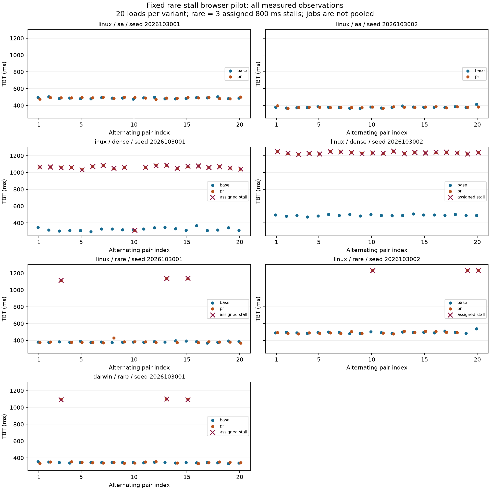

# Rare-stall browser pilot, 30 October 2026

This report follows the [predeclared protocol](tail-browser-protocol-2026-10-30.md)
and source freeze in docs/protocols/tail-browser-pilot-2026-10-30.json. It describes
an exploratory measured-browser pilot; it does not replace the main candidate's
confirmatory cohort or establish general detection power.

## What is being tested

The same heavy application is served through a separate page with a traceable
main-thread stall probe. A/A has no stall; rare has three predetermined PR loads
out of twenty with an 800 ms wall-clock stall; dense has a stall in every PR load.
The baseline is always clean. Both variants run the same probe infrastructure.

The two hosted seeds select rare indices [2, 12, 14] and [9, 18, 19] (zero-based).
This fixes the contamination count at 15%; it is not a Bernoulli model. Warmups
are clean. All complete series have 20 measured loads per variant and two warmups
per variant. Local and hosted samples are analyzed separately.

The instrumentation smoke contained two clean and two stalled loads. Timing marks
confirmed approximately 800 ms stalls, and measured TBT increased from roughly
340–360 ms to 1,090 ms. That check preceded the source freeze and is excluded from
the pilot results.

## Completed results

[Hosted acquisition](https://github.com/SlavaDoroshenko/perfgate/actions/runs/41035614668)
completed all six jobs. [Raw data, traces and checksums](https://github.com/SlavaDoroshenko/perfgate/tree/8fd51f7/comparisons/tail-browser-pilot-2026-10-30)
are archived separately from historical raw data. Together with the local rare job, the pilot contains
280 measured loads and 28 warmups, with zero failed or invalid jobs. All 49 assigned
stalls were confirmed by trace marks (799.950–802.360 ms). All planned slots and
source hashes match the frozen protocol.

| Rare-stall job | Mean TBT change | Median TBT change | Complete gate | Target TBT |
|---|---:|---:|---|---|
| Linux, seed 01 | +29.13% | −0.17% | Quiet | Not detected |
| Linux, seed 02 | +21.81% | −0.12% | Quiet | Not detected |
| macOS, seed 01 | +32.81% | +0.78% | Quiet | Not detected |

Both A/A jobs are quiet under the complete gate. Both dense controls trigger the
gate on TBT and LCP. Among the twelve exploratory per-TBT rules, only Welch flags
all three rare jobs; the other eleven flag none of those three jobs. Every rule
flags both dense controls. The single-run >2% rule also flags one A/A job; all other
rules are quiet in both A/A jobs. These are observed outcomes of this pilot, not
estimates of sensitivity/specificity or a basis for declaring Welch universally
superior. The permutation-mean test did not detect the sparse changes here.

In the local rare series, mean TBT is 344.18 → 457.09 ms, while the median is
344.86 → 347.55 ms. Thus the median-oriented candidate has a concrete blind spot
for this measured distributional change. A broad claim that it detects arbitrary
performance regressions would be unsupported.



[Per-job outcomes](results/2026-10-30/tail-pilot/jobs.csv),
[all method decisions](results/2026-10-30/tail-pilot/methods.csv), and
[decision figure](results/2026-10-30/tail-pilot/methods.png) preserve every outcome.
Acquisition including clean warmups took approximately 778–818 seconds per job;
these durations include this diagnostic collector's evidence-writing overhead.

## Additional timing limitation

A post-pilot trace check found one dense-control load (seed 01, index 9) whose
800.722 ms stall ended 32.448 ms before FCP. Its TBT is only 312.467 ms, and it remains
in every analysis. The other 48 assigned stalls overlap time after FCP; many start
a few milliseconds before it. The load/rAF/timer scheduling therefore does not
guarantee an entirely post-FCP treatment. The protocol required verified execution,
not an 800 ms TBT increment, so no job is reclassified or dropped after this finding.

This is consistent with [TBT's post-FCP measurement window](https://web.dev/articles/tbt).
Execution of a task and its contribution to a particular metric are distinct.
A future fixture version should explicitly anchor scheduling to observed paint and
be validated in a new cohort. The current frozen fixture is retained. Reproduce
the exploratory timing check with scripts/diagnose-tail-paint.py; all offsets are
in [stall-paint-timing.csv](results/2026-10-30/tail-pilot/stall-paint-timing.csv).

## How to read the comparison

The complete candidate uses one-sided MWU, Holm over four metrics, and an observed
median margin (TBT >max(5%, 5 ms)). Its target-TBT verdict is reported separately
from alarms on other metrics. A quiet result is not proof that the workload is
unchanged.

The twelve exploratory TBT rules use the identical observations, but have different
endpoints and null hypotheses. Their decisions are unadjusted across methods and
must not be interpreted as twelve independent confirmations. Single-run rules
consume only the first observation; bootstrap/median rules target median behavior,
whereas Welch and permutation mean respond to mean shifts under their respective
assumptions. Empirical p95/max are descriptive at this sample size.

A small pilot can establish that the stall was executed and show how algorithms
respond in these particular series. It cannot estimate a detector's error rate,
prove superiority, or justify changing the frozen candidate thresholds.

## Reproduction

Build the ordinary app and collector, generate the separate fixture, and start the
server after generation. The collector verifies the frozen source hashes before
main acquisition and refuses an existing output directory.

```sh
pnpm --filter demo-spa build
pnpm --filter @perfgate/collector build
node scripts/prepare-tail-fixture.mjs
pnpm --filter demo-spa preview
# In another terminal with the pinned CHROME_PATH:
node scripts/collect-tail.mjs --url http://127.0.0.1:4173/tail-heavy.html \
  --out results/new-tail --condition rare --seed 2026103001 --experiment new-tail
PYTHONPATH=analysis analysis/.venv/bin/python scripts/analyze-tail.py \
  results/new-tail --out results/new-tail-analysis
```

The hosted workflow supports manual dispatch. In a PR, an explicit [tail-pilot]
marker in the head commit subject requests the six predeclared jobs; ordinary
follow-up commits do not silently start another pilot. A new execution is another
cohort, not a replacement for any unfavorable result.

## Scope of the evidence

TBT is a laboratory main-thread metric, not a direct measurement of field INP or
user interaction latency. The workload is synthetic, the stall is wall-clock
controlled, and the job count is small. The tail workload has a new fingerprint;
its A/A jobs do not count toward the primary four-page prospective A/A cohort.
No metric threshold, source of the frozen gate, assignment schedule or sample size
was changed after looking at pilot measurements.

The analysis retains incomplete/invalid jobs and checks every planned warmup/load,
trace evidence and acquisition freeze. The original records can also be replayed
through the normal perfgate compare path. Full LHRs are retained for every load;
full traces are retained for all assigned stalls and the first measured pair.

## Validation and next decision

All 80 Python tests pass locally, including the new whole-job integrity tests.
The three new Node protocol tests pass; the existing 39 JavaScript tests pass in
CI along with builds/typecheck. The CI Python run has 79 passes and one historical
Git test skipped because its checkout is shallow; the same test passes locally.

The product policy is unchanged. The next step is to predeclare and compare an
additional mean/tail endpoint with adequate null controls and multiple-testing
handling, using equal-load and equal-time budgets. This pilot alone does not
justify swapping MWU for Welch or adding an uncalibrated blocking rule.
